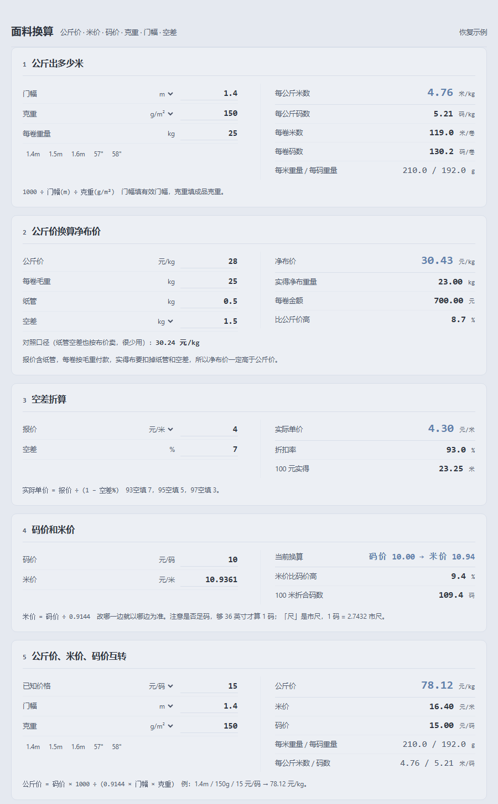

# 面料换算工具 · Fabric Converter

> 面料报价最常用的 5 种换算，一个 HTML 文件搞定。双击即用，不装软件、不联网、不上传数据。



做面料生意时，同一块布要同时面对公斤价、米价、码价、克重、门幅、空差、纸管、净布价——
一边接电话一边在计算器上按，很容易按错。这个工具把这几步固化成 5 张卡片，输入即出结果，公式直接印在卡片上，随时可核对。

## 功能

| 卡片 | 换算 | 公式 |
|---|---|---|
| ① | 1 公斤出多少米 | `1000 ÷ 门幅(m) ÷ 克重(g/m²)` |
| ② | 公斤价 → 净布价 | `公斤价 ÷ 25 × (25 + 纸管 + 空差)`，并给出净重口径对照 |
| ③ | 空差折算 | `实际单价 = 报价 ÷ (1 − 空差%)`，如「93空」= 4 ÷ 0.93 |
| ④ | 码价 ⇄ 米价 | `米价 = 码价 ÷ 0.9144`（1 码 = 0.9144 米） |
| ⑤ | 公斤价 ⇄ 米价 ⇄ 码价 | `公斤价 = 码价 × 1000 ÷ (0.9144 × 门幅 × 克重)` |

具体的：

- **① 1 公斤出多少米**：给门幅和克重，得出 1 kg 出几米、几码，以及每卷（可填卷重，默认 25kg）出多少米，方便验货点数
- **② 公斤价 → 净布价**：同时给两种行业口径，差价就是可谈空间
  - 笔记口径：`公斤价 ÷ 25 × (25 + 纸管 + 空差)`，把纸管、空差当作额外计费重量加上去
  - 净重口径：`公斤价 × 25 ÷ (25 − 纸管 − 空差)`，标称卷重扣掉纸管和空差后，你真正拿到那点布的单价
- **③ 空差折算**：市场说的「不足码 / 短码」也是这一条，顺带告诉你 100 元货款实际能拿到多少数量
- **④ 码价 ⇄ 米价**：改任意一边，另一边自动算
- **⑤ 三价互转**：输入任一价格 + 门幅 + 克重，一次给出元/kg、元/米、元/码

## 使用方法

1. 下载 `index.html`（或整个仓库）
2. 双击用浏览器打开（Edge / Chrome / Safari 都行）

其他用法：

- **手机上用**：把 `index.html` 发到微信「文件传输助手」，在手机上用浏览器打开即可，界面自适应
- **发给同事**：就一个文件，直接发过去
- **复制结果**：点任意结果数字即可复制

## 单位支持

| 项目 | 可选单位 | 说明 |
|---|---|---|
| 门幅 | m / cm / 英寸 | 梭织布常见的 57"、58" 可直接选，卡片里还有 `1.4m`、`57"` 等快捷按钮 |
| 克重 | g/m² / oz/yd² | 牛仔布常说 10oz、11oz，选 oz/yd² 即可（1 oz/yd² ≈ 33.9057 g/m²） |
| 空差 | kg / 按 % | 有的供应商直接报 7%，有的报 1.5kg，两种都能填 |
| 价格 | 元/kg、元/米、元/码 | —— |

## 换算常数

| 常数 | 值 | 来源 |
|---|---|---|
| 1 码 | 0.9144 米 | 国际码定义，精确值 |
| 1 英寸 | 0.0254 米 | 国际英寸定义，精确值 |
| 1 oz/yd² | 33.9057 g/m² | 28.349523125 g ÷ 0.83612736 m² |

## 使用提醒

- **门幅填有效门幅**（布边不算），梭织要确认是不是「边到边」门幅
- **克重填成品克重**，不是毛坯克重，否则算出的米数会偏多
- 报价里说的「93空」= 空差 7%，填 `7`；如果对方直接说「93折」含义相同
- 足码问题：够 36 英寸才算 1 码，报价前先问清楚是否足码
- ②的两种净布价口径结果不同（示例里相差 0.19 元/kg），谈价时先确认对方按哪一种

## 开发与自检

计算逻辑全部集中在 `index.html` 的 `// ==== MATH START ====` 与 `// ==== MATH END ====` 之间，纯函数、无依赖、可单独提取。

改动后跑自检（需要 Node.js ≥ 18）：

```bash
node test/check.mjs
# 或
npm test
```

自检会：从 HTML 中提取计算逻辑 → 验证 5 个公式的已知算例 → 校验三价互转一致性 → 校验单位换算 → 校验非法输入不会产生 `Infinity`/负价格 → 校验页面引用的元素 id 是否存在、快捷选项是否指向有效元素、是否零外部依赖。当前 **48 项断言**。

## 已知取舍

- 只做「价格/长度/重量」三类换算，不涉及含税、含运费、汇率、损耗率——这些因公司而异，硬编码反而误导
- 结果保留 2 位小数显示，不自动做「取整到 0.5 元」这类报价凑整
- 不考虑染整缩率对克重、门幅的影响，需要用最终成品参数来算

## License

[MIT](LICENSE) · 随便用、随便改，出了报价错误概不负责 🙂

---

### English

A single-file, offline fabric quotation converter for the textile trade: weight-per-kg (GSM/width), price per kg ⇄ per meter ⇄ per yard, and the "empty difference" (空差, short-length allowance) deduction used in Chinese fabric markets. No build step, no dependencies, no network. Open `index.html` in any browser.
